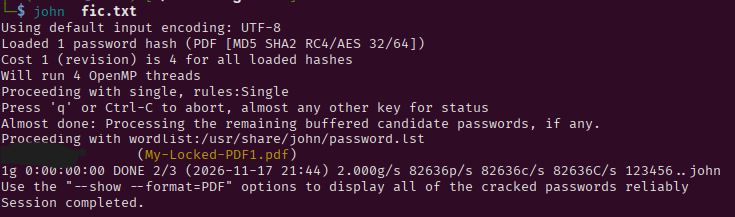
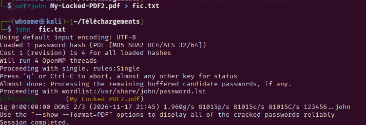
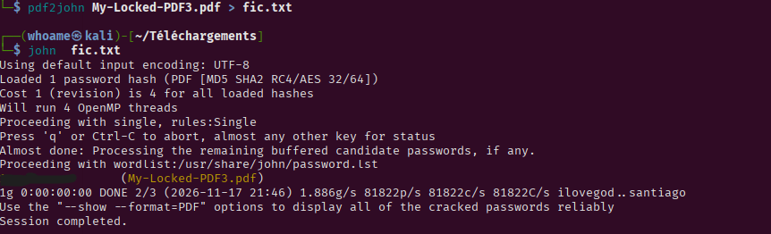
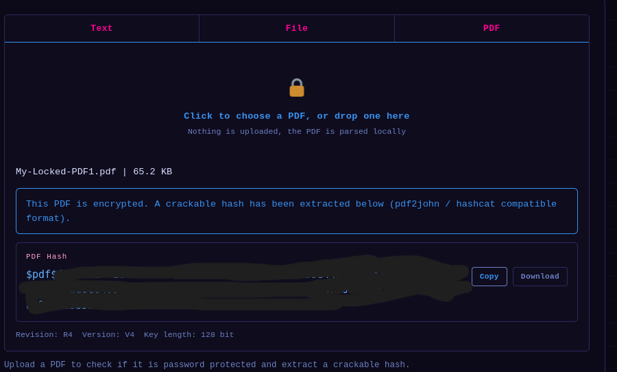
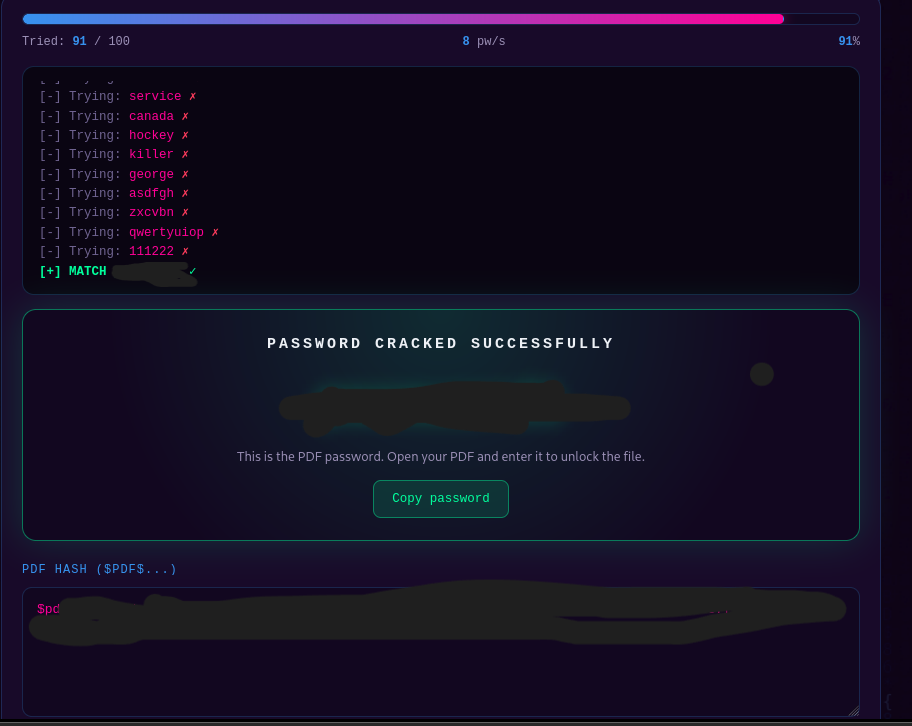
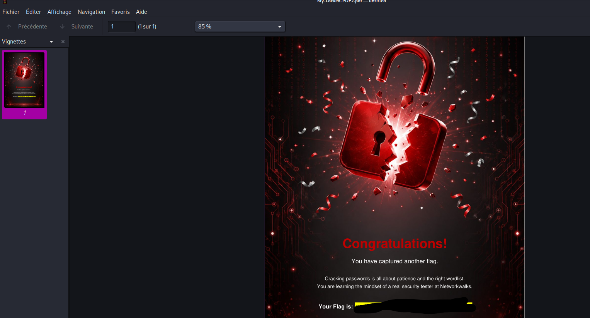

# Password Cracking — Networkwalks Batch B084

🇬🇧 English | 🇫🇷 Français

## English
Overview

This module covers password cracking techniques, applied to three password-protected PDF files.

## Target files
My Locked PDF1.pdf
My Locked PDF2.pdf
My Locked PDF3.pdf

## Module 1 — Cracking with John the Ripper

1. Extract the hash from each PDF with pdf2john:

```bash
pdf2john "My Locked PDF1.pdf" > hash1.txt
pdf2john "My Locked PDF2.pdf" > hash2.txt
pdf2john "My Locked PDF3.pdf" > hash3.txt
```

2. Crack each hash with John the Ripper, using the default wordlist (password.lst), since the passwords were expected to be simple:

```bash
john --wordlist=/usr/share/john/password.lst hash1.txt
john --wordlist=/usr/share/john/password.lst hash2.txt
john --wordlist=/usr/share/john/password.lst hash3.txt
``` 

3. Display the recovered passwords:

```bash
john --show hash1.txt
```
✅ All three passwords were successfully recovered 






## Module 2 — Cracking with the Networkwalks Online Tools

For this module, no John the Ripper — two Networkwalks web tools were used instead:

Hash Calculator — to compute the hash value of the PDF file.
Password Cracker — to crack that hash and recover the password.

✅ Password successfully recovered this way as well.








Lessons learned
The default John wordlist was enough here because the passwords were simple.
Against more complex passwords, a larger wordlist (e.g. rockyou.txt) would be needed instead.
Screenshots


## Français
Présentation

Ce module porte sur le cassage de mots de passe, appliqué à trois fichiers PDF protégés.
Fichiers cibles
My Locked PDF1.pdf
My Locked PDF2.pdf
My Locked PDF3.pdf
Module 1 — Cassage avec John the Ripper

1. Extraction du hash de chaque PDF avec pdf2john :

```bash
pdf2john "My Locked PDF1.pdf" > hash1.txt
pdf2john "My Locked PDF2.pdf" > hash2.txt
pdf2john "My Locked PDF3.pdf" > hash3.txt
```
2. Cassage de chaque hash avec John the Ripper, via la wordlist par défaut (password.lst), les mots de passe étant attendus comme simples :

```bash
john --wordlist=/usr/share/john/password.lst hash1.txt
john --wordlist=/usr/share/john/password.lst hash2.txt
john --wordlist=/usr/share/john/password.lst hash3.txt
```
3. Affichage des mots de passe retrouvés :

```bash
john --show hash1.txt
```
✅ Les trois mots de passe ont été retrouvés avec succès.


## Module 2 — Cassage avec les outils en ligne Networkwalks

Pour ce module, pas de John the Ripper : deux outils web Networkwalks ont été utilisés à la place :

Hash Calculator — pour calculer la valeur de hash du fichier PDF.
Password Cracker — pour casser ce hash et retrouver le mot de passe.

✅ Mot de passe retrouvé avec succès par cette méthode également.


Points à retenir
La wordlist par défaut de John a suffi ici, les mots de passe étant simples.
Face à des mots de passe plus complexes, une wordlist plus large (ex. rockyou.txt) serait nécessaire.

